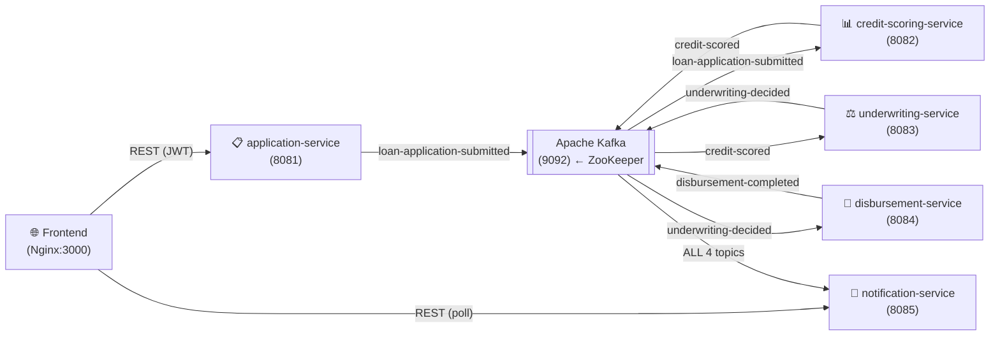

# LoanFlow — System Architecture Deep Dive

## Big Picture: What Kind of System Is This?

LoanFlow is a **distributed, event-driven microservices system** that processes loan applications from intake to fund disbursement. Instead of one big app ("monolith"), it's split into **five independent Java/Spring Boot services** that never call each other directly — they communicate exclusively through **Apache Kafka**, a distributed message broker.

---

## System Topology



The key insight: **every arrow through Kafka is asynchronous**. No service blocks waiting for another.

---

## Service-by-Service Breakdown

---

### 1. `application-service` — The Entry Gate (Port 8081)

**Role:** The *only* service the frontend talks to for write operations. It owns authentication, user registration, and loan intake.

**How it works internally:**

1. **Auth endpoints** (`/api/v1/auth/register`, `/api/v1/auth/login`) — Accepts credentials, hashes passwords with `BCrypt`, and issues signed **JWT tokens** (stateless sessions — no server-side session state).
2. **JwtAuthenticationFilter** — A Spring Security filter that intercepts every request, validates the JWT from the `Authorization` header, and injects the user's identity into the request context before it reaches any controller.
3. **Loan Submission** (`POST /api/v1/applications`) — The main business endpoint:
   - Looks up the `Applicant` entity from the DB by the JWT's email.
   - **Dynamically updates** `ssn` and `monthlyIncome` on that applicant record (this was the earlier bug fix — ensuring the fields you type in the form actually persist and influence scoring).
   - Creates a `LoanApplication` record with status `SUBMITTED`.
   - Builds an `ApplicationSubmittedEvent` containing all relevant financial data (SSN, income, requested amount, etc).
   - **Publishes this event to Kafka topic `loan-application-submitted`**.
   - Returns a `202 Accepted`-style response immediately — the pipeline processing happens asynchronously.

**Why it exists separately:** Separation of Concerns. Auth + intake is a security boundary. Other services never touch user credentials or raw PII directly.

**Database:** H2 in-memory (dev mode) with tables `applicants` and `loan_applications`.

---

### 2. `credit-scoring-service` — The Risk Rater (Port 8082)

**Role:** Consumes the submitted event and computes a credit score — the first step in the automated pipeline.

**How it works internally:**

```
ApplicationSubmittedEvent consumed
          ↓
ExternalCreditBureauClientImpl.fetchScoreFromBureau(ssn)
  → Hashes the SSN → baseScore between 600–850
  → SSNs ending in "9999" → throws 503 exception  ← Circuit Breaker triggers
          ↓
DTI Ratio = (requestedAmount × 0.05) / monthlyIncome
  → DTI ≤ 0.20  → score += 70  (low-debt applicant bonus)
  → DTI > 0.45  → score -= 60  (high-debt penalty)
          ↓
CreditTier assigned (EXCELLENT/GOOD/FAIR/POOR)
          ↓
CreditReport saved to DB
          ↓
CreditScoredEvent published → topic: "credit-scored"
```

**The Circuit Breaker (Resilience4j):**

The `@CircuitBreaker(name = "creditBureauService", fallbackMethod = "fallbackCreditEvaluation")` annotation wraps the bureau call. If the bureau throws exceptions repeatedly (simulated by SSNs ending in `9999`):
- After a threshold of failures, the circuit "opens" — subsequent requests skip the bureau call entirely and go straight to `fallbackCreditEvaluation`.
- The fallback assigns a conservative `score=600, tier=FAIR` and sets `isFallbackUsed=true` so downstream can flag it.
- After a timeout, the circuit goes "half-open" and probes the bureau again.

**The SSN-deterministic scoring:** `600 + Math.abs(ssn.hashCode() % 250)` — same SSN always produces the same base score. This is intentional for testability — you can predict the base score from your SSN input.

**Why separate from underwriting?** Credit scoring has a distinct external dependency (the bureau API). Isolating it means its circuit breaker, retry logic, and SLAs don't pollute underwriting decisions.

---

### 3. `underwriting-service` — The Decision Maker (Port 8083)

**Role:** Listens for `CreditScoredEvent`, applies business rules to make a loan approval decision.

**How it works internally:**

```
CreditScoredEvent consumed
          ↓
Automated rule engine:
  score ≥ 750  → APPROVED  @ 5.5% interest rate
  score ≥ 700  → APPROVED  @ 7.5% interest rate
  score < 550  → REJECTED
  550–699      → FLAGGED_FOR_MANUAL_REVIEW  (no event published yet)
          ↓
UnderwritingDecision saved to DB
          ↓
If APPROVED or REJECTED → UnderwritingDecidedEvent published → "underwriting-decided"
If MANUAL_REVIEW       → sits in DB, waits for human input
```

**The Manual Adjudication Path:**

When a score is in the 550–699 "grey zone", the system doesn't auto-decide. An underwriter (via the UI or API) calls `POST /api/v1/underwriting/{id}/manual-decision` with their verdict. The service then:
1. Updates the stored `UnderwritingDecision` entity.
2. Records the `underwriterId` for audit trail.
3. Publishes the `UnderwritingDecidedEvent` — which unblocks the rest of the pipeline.

**Why is the manual path so important?** In real lending, regulations (e.g., ECOA, FCRA) require human oversight for borderline cases. This pattern is architecturally sound: the automated path is fast, the manual path is compliant.

---

### 4. `disbursement-service` — The Money Mover (Port 8084)

**Role:** The final automated step. Transfers approved loan funds.

**How it works internally:**

```
UnderwritingDecidedEvent consumed
          ↓
If status ≠ APPROVED → throws BusinessLogicException (skips disbursement)
          ↓
idempotencyKey = "DISB-AUTO-APP-{applicationId}"
          ↓
Check IdempotencyLog table for this key
  → Key EXISTS → return cached DisbursementResponse, set isDuplicateRequest=true
  → Key NOT EXISTS → proceed
          ↓
Generate transactionRef "TXN-{UUID}"
Create Disbursement entity → status=SUCCESS
Save IdempotencyLog with JSON response snapshot
          ↓
DisbursedEvent published → "disbursement-completed"
```

**The Idempotency Pattern — why it matters:**

In distributed systems, Kafka can (and does) redeliver messages during failure scenarios. Without idempotency, a network blip could cause the same loan to be funded twice. The solution:
- A **unique idempotency key** is derived from the `applicationId` (deterministic and business-meaningful).
- Before any DB write or money transfer, the key is looked up in `IdempotencyLogRepository`.
- If found — the exact same JSON response is returned, **without re-executing the transfer**.
- The `isDuplicateRequest: true` flag in the response makes the duplicate visible in logs/audit.

This is a **write-once, read-many** ledger pattern, standard practice in payments infrastructure.

---

### 5. `notification-service` — The Aggregator & SSE Broadcaster (Port 8085)

**Role:** A pure consumer. It subscribes to **all four Kafka topics** simultaneously and aggregates events into a queryable store that the frontend polls.

```java
@KafkaListener(topics = "loan-application-submitted", groupId = "notification-group")
@KafkaListener(topics = "credit-scored",              groupId = "notification-group")
@KafkaListener(topics = "underwriting-decided",       groupId = "notification-group")
@KafkaListener(topics = "disbursement-completed",     groupId = "notification-group")
```

**What it does per event:**
- Receives the event object (deserialized from JSON).
- Saves a `Notification` entity to its own DB with message text, type, timestamp, and application ID.
- The frontend calls `GET /api/v1/notifications` to fetch these, giving users a real-time audit trail of the pipeline.

**Why is this its own service?** The Notification Service has a `notification-group` consumer group ID. Kafka delivers each message to **one consumer per group**. This means notifications are independent — even if the credit scoring consumer is slow, the notification consumer processes at its own pace. They don't block each other.

---

## How Kafka Connects Everything

### What Is Kafka, Really?

Kafka is a **distributed commit log** — an ordered, append-only sequence of records that many processes can read independently. It's not a message queue where messages disappear after consumption — messages are **retained** (by default for 7 days) and each consumer tracks its own offset (position).

### The Four Topics in LoanFlow

| Topic | Producer | Consumer(s) |
|---|---|---|
| `loan-application-submitted` | application-service | credit-scoring-service, notification-service |
| `credit-scored` | credit-scoring-service | underwriting-service, notification-service |
| `underwriting-decided` | underwriting-service | disbursement-service, notification-service |
| `disbursement-completed` | disbursement-service | notification-service |

### Consumer Groups — The Critical Concept

Each service uses a **different consumer group ID**:
- `credit-scoring-group`
- `underwriting-group`
- `disbursement-group`
- `notification-group`

Kafka tracks offsets **per group**. So when `loan-application-submitted` is published:
- `credit-scoring-group` reads it for scoring
- `notification-group` reads it *independently* for UI notification

Both get the same message. Neither knows the other exists. This is **fan-out** — one event, multiple independent consumers.

### Message Key = Ordering Guarantee

Notice every `kafkaTemplate.send(topic, key, event)` uses `applicationId.toString()` as the key. Kafka guarantees that all messages with the **same key go to the same partition**, which means all events for a given loan application are processed **in order** by each consumer. This prevents race conditions like disbursement arriving before underwriting.

---

## The Saga Pattern

The entire flow is a **Choreography-based Saga** — a distributed transaction pattern for eventual consistency:

```
Saga Step 1: application-service   → SUBMIT  → emits ApplicationSubmittedEvent
Saga Step 2: credit-scoring-service → SCORE   → emits CreditScoredEvent
Saga Step 3: underwriting-service  → DECIDE  → emits UnderwritingDecidedEvent
Saga Step 4: disbursement-service  → DISBURSE → emits DisbursedEvent
```

Each step is a local transaction. If a step fails, **compensating transactions** (e.g., marking the application FAILED) would be published — the system "rolls back" through events rather than through a 2-phase commit across databases.

**Choreography vs. Orchestration:**
- This system uses **Choreography** — each service reacts to events independently, no central controller.
- The alternative (Orchestration) would use a Saga Orchestrator service that explicitly calls each step and manages state.
- Choreography is simpler to implement but harder to debug across services; Orchestration is more complex but gives you a single place to see the entire state.

---

## Architecture Tradeoffs

### ✅ What You Gain

| Property | How LoanFlow achieves it |
|---|---|
| **Decoupling** | Services don't know each other's addresses or APIs. Add a new consumer with zero changes to producers. |
| **Resilience** | If credit-scoring-service crashes, application-service keeps accepting submissions. Events buffer in Kafka until the consumer recovers. |
| **Scalability** | Each service scales independently. 10× more applications? Scale only application-service and credit-scoring-service. |
| **Audit Trail** | Kafka retains every event. You have a complete, immutable history of every state transition. |
| **Idempotency** | Safe to retry any step without double-disbursement. |

### ⚠️ What You Trade Away

| Tradeoff | Explanation |
|---|---|
| **Eventual Consistency** | After submitting a loan, the score isn't available for milliseconds to seconds. The UI must poll for updates rather than getting an immediate response. |
| **Distributed Debugging** | A bug might be in any of 5 services. You need distributed tracing (e.g., Jaeger, Zipkin) to correlate logs across services. A `correlationId` propagated in events helps. |
| **Operational Complexity** | You need Kafka + ZooKeeper running before any service works. In production this is a managed cluster (Confluent Cloud, AWS MSK, etc). |
| **No Atomic Rollback** | If disbursement fails after underwriting succeeded, you need a compensating event. There's no `ROLLBACK` across service boundaries. |
| **Message Ordering Edge Cases** | In this setup, `replication_factor=1` and single-broker means no HA for Kafka itself. In production you'd have 3+ brokers. |
| **Latency** | Async processing means a full loan pipeline takes longer wall-clock time than a synchronous HTTP chain would. Acceptable for loans; not for user-facing search. |

---

## Infrastructure: ZooKeeper + Kafka Internals

- **ZooKeeper (port 2181):** Kafka's cluster coordinator. Tracks which brokers are alive, which partitions are leader, and stores consumer group offsets (pre-Kafka 2.8 behavior — newer Kafka uses KRaft which eliminates ZooKeeper).
- **Kafka Broker (port 9092 external / 29092 internal):** Receives, persists, and serves messages. `PLAINTEXT_INTERNAL://kafka:29092` is used inside Docker's network; `PLAINTEXT://localhost:9092` is for connections from outside Docker.
- **`replication.factor=1`:** All topics have 1 replica — acceptable in dev, catastrophic in production (single point of failure). Production uses factor=3.

---

## The Frontend's Role

The frontend is a static HTML/CSS/JS app served by Nginx. It is not a microservice — it's a **consumer of services**:

1. Calls `application-service` for auth and loan submission.
2. Polls `notification-service` for pipeline status updates.
3. Has no direct knowledge of credit-scoring, underwriting, or disbursement — it only sees the notifications those services indirectly produce.

This means the frontend is **decoupled from the pipeline** — it doesn't break if underwriting is down, it just won't show update notifications until the service recovers.
